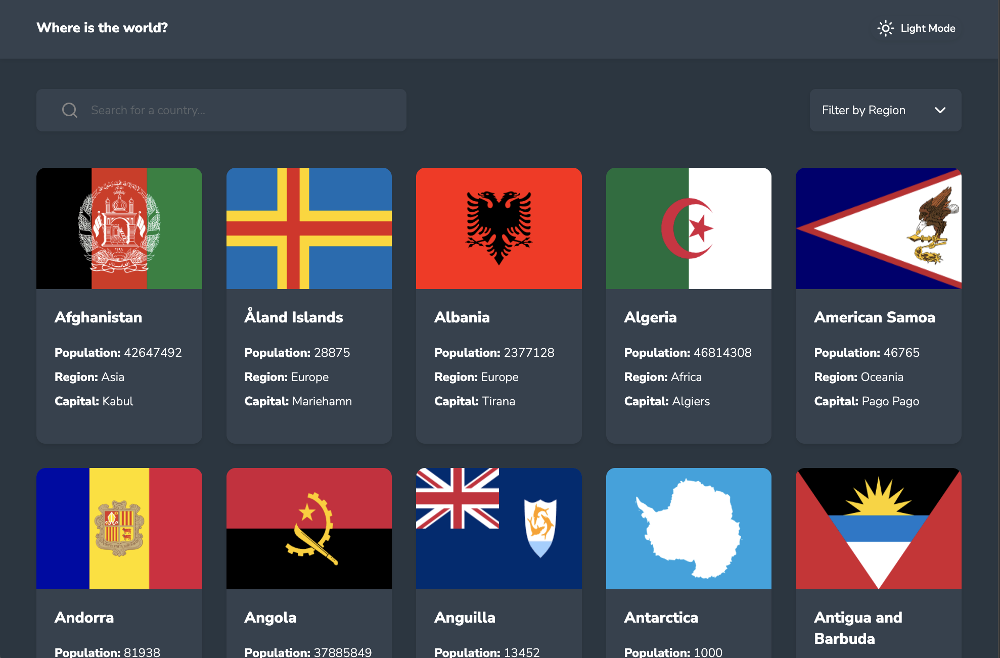
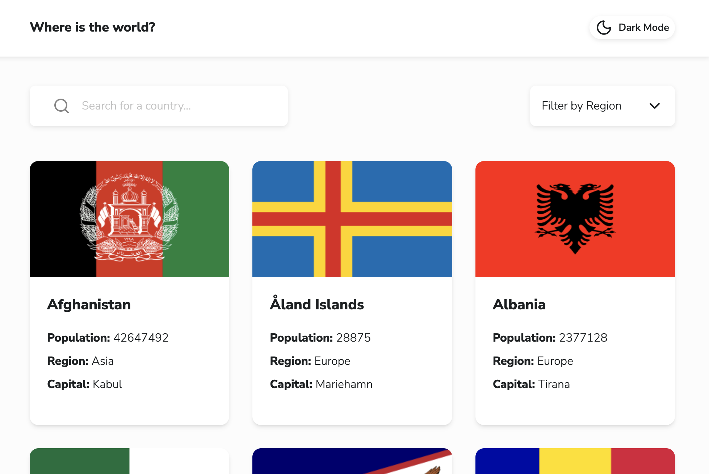

# Frontend Mentor - REST Countries API with color theme switcher solution

This is a solution to the [REST Countries API with color theme switcher challenge on Frontend Mentor](https://www.frontendmentor.io/challenges/rest-countries-api-with-color-theme-switcher-5cacc469fec04111f7b848ca). Frontend Mentor challenges help you improve your coding skills by building realistic projects.

## Table of contents

- [Overview](#overview)
  - [The challenge](#the-challenge)
  - [Screenshot](#screenshot)
  - [Links](#links)
- [My process](#my-process)
  - [Built with](#built-with)
  - [What I learned](#what-i-learned)
- [Author](#author)

## Overview

### The challenge

Users should be able to:

- See all countries from the data on the homepage
- Search for a country using an `input` field
- Filter countries by region
- Click on a country to see more detailed information on a separate page
- Click through to the border countries on the detail page
- Toggle the color scheme between light and dark mode _(optional)_

### Screenshot

### Links

- Solution URL: [GitHub](https://github.com/piyush-kaushik24/rest-countries-api)
- Live Site URL: [REST Countries API with color theme switcher](https://rest-countries-api-e5ao.vercel.app/)

## My process

### Built with

- Semantic HTML5 markup
- CSS custom properties
- Flexbox
- CSS Grid
- Mobile-first workflow
- [TypeScript](https://www.typescriptlang.org/)
- [React](https://react.dev/) - JS library
- [Tailwind CSS](https://tailwindcss.com/) - CSS framework

### What I learned

- Built a responsive country information application using React, TypeScript, Vite, Tailwind CSS, and React Router.

- Learned how to fetch local JSON data using the Fetch API and manage loading, error, and data states with a custom useFetch hook.

- Learned how to handle HTTP responses using response.ok and response.status and display appropriate error states.

- Created reusable custom hooks for data fetching, debouncing, and localStorage.

- Practiced using React Router for nested routes and dynamic country detail pages.

- Learned how to use URL parameters with useParams() and navigate programmatically with useNavigate().

- Practiced finding specific country data using .find() and using country codes to link between border countries.

- Implemented search and region filtering while keeping the original country data as the source of truth.

- Practiced creating accurate TypeScript types for nested API-style data such as countries, currencies, languages, and flags.

- Improved accessibility by using meaningful labels, accessible button names, aria-pressed, and aria-hidden for decorative icons.

- Learned how to think about state ownership, derived data, component responsibilities, and edge cases rather than only making the UI work.

## Author

- GitHub - [@piyush-kaushik24](https://github.com/piyush-kaushik24)
- Frontend Mentor - [@piyush-kaushik24](https://www.frontendmentor.io/profile/piyush-kaushik24)
